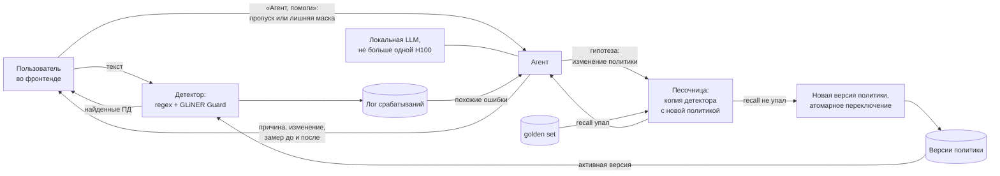
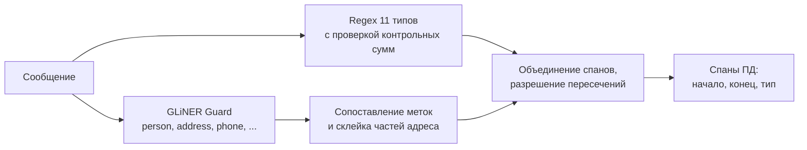
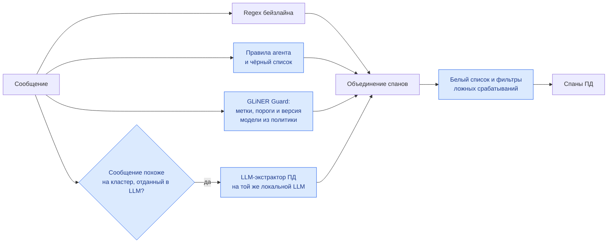
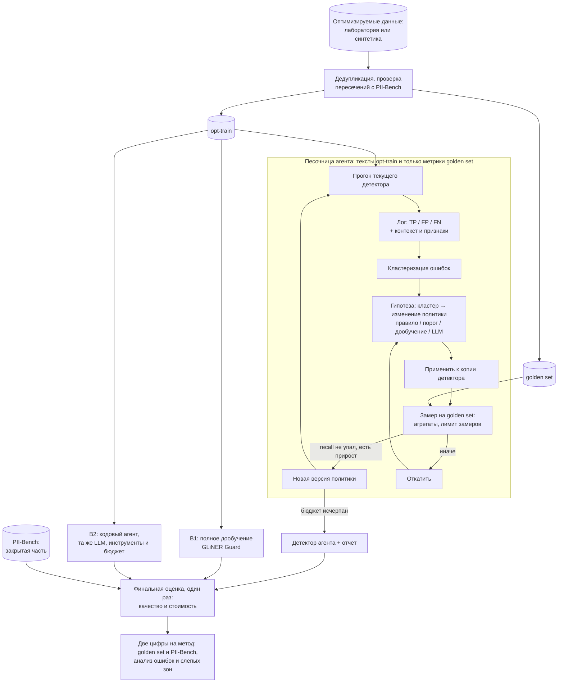

# ML System Design Doc

## Дизайн ML-системы — Self-improving PII detection, MVP, итерация 1

Локальный агент, который находит причины ошибок детектора персональных данных (ПД) в русскоязычных текстах и исправляет их прямо в работающем сервисе, без правки исходного кода

### Пояснение терминов

- **ПД** — персональные данные: ФИО, телефон, email, адрес, номера карт, CVC, ИНН, СНИЛС и т.п.
- **Детектор** — система, которая находит в тексте фрагменты (спаны) с ПД: начало, конец, тип. Бейзлайн — regex + GLiNER
- **Политика детектора** — версионируемая конфигурация детектора: regex-правила, белые и черные списки, метки и пороги модели, правила склейки и разрешения пересечений, правила маршрутизации в LLM. Агент меняет только политику, а не исходный код
- **Лог срабатываний** — результат работы детектора с отметками: верное срабатывание (TP), ложное срабатывание (FP), пропуск (FN)
- **Кластер ошибок** — группа FP или FN с общей причиной ошибки: проблема с детекцией ФИО, указанных в косвенном падеже, номер заказа детектируется как ПД, адрес распознается по частям, а не как единое целое
- **Исправление** — изменение политики под кластер ошибок
- **Golden set** — размеченный набор, на котором агент проверяет каждое исправление перед внесением правки
- **Оптимизируемая часть** — данные, к которым у агента есть доступ: к текстам или только к метрикам. В неё входит golden set
- **Закрытая часть** — данные, которые агент не видит ни в каком виде. На ней один раз считается итоговое качество

### 1. Цели и предпосылки

#### 1.1. Зачем идём в разработку продукта?

**Бизнес-цель.** Клиенты хотят пропускать через LLM рабочие тексты: обращения в поддержку, переписку в мессенджерах, корпоративные документы. В этих текстах есть персональные данные. Попадание ПД в LLM создает серьезные юридические риски (152-ФЗ «О персональных данных»). Поэтому перед LLM встраивают модуль детекции ПД: NER-модуль из regex-правил и GliNER моделей. Данный модуль недостаточно надежен, существует несколько типов ошибок, которые не определяются данным модулем, клиенты регулярно приходят с новыми примерами недетектированных ПД и просят внести исправление. Эти исправления приходится вносить вручную, а между внесенным исправлением и релизом в продакшн проходит значительное время (до 1-1.5 месяцев). Соответственно, есть потребность в агенте, который смог бы в режиме реального времени улучшать детекцию ПД, при этом не внося изменения в исходный код.

**Как сейчас.** Детектор улучшает инженер вручную: читает логи пропусков и ложных срабатываний, правит regex-правила в коде, собирает данные и дообучает NER-модель, затем выкатывает новую версию. Есть белые и чёрные списки, но они помогают не всегда, так как помогают разобраться только с отдельно взятыми примерами, а не с группой ошибок как таковой.

**Почему станет лучше с агентом.** Гипотеза проекта: ошибки детектора не размазаны равномерно, а собираются в группы: сценарий (банк, доставка, HR), шаблон фразы, формат записи, тип сущности. Агент, получив одну ошибку, может найти в логе похожие, понять общую причину и подобрать самое дешёвое исправление

**Что считаем успехом итерации.** У итерации две ветки

Продуктовая: работает сервис с фронтендом, на котором виден happy path: детектор ошибся → пользователь нажимает «Агент, помоги» → агент сам находит причину, проверяет исправление на golden set и применяет его в рантайме, не снижая recall и не ломая текущий инференс

Исследовательская — ответ на два вопроса с цифрами:

1. Насколько сильно кластеризуются ошибки бейзлайна (regex + GLiNER)?
2. Улучшает ли агент детектор сильнее, чем полное дообучение и обычный кодовый агент с теми же инструментами, по качеству на закрытой части и по стоимости инференса?

#### 1.2. Бизнес-требования и ограничения

**Бизнес-требования.**

| № | Требование |
|---|---|
| БТ-1 | В чувствительных сценариях (банк, телеком, HR, недвижимость, поддержка) пропуск ПД дороже ложного срабатывания: пропуск — это утечка. В обычной переписке, где ПД редки, важнее не портить текст лишними масками. Метрики учитывают оба режима. |
| БТ-2 | Исправления не требуют правки исходного кода: агент меняет только политику детектора. |
| БТ-3 | Исправление применяется в рантайме и не ломает текущий инференс: без перезапуска, без потерянных или ошибочных запросов во время переключения. Любую версию политики можно откатить. |
| БТ-4 | Исправление применяется, только если recall на golden set не падает — ни в целом, ни по отдельным типам ПД. |
| БТ-5 | Каждое исправление объяснимо: пользователь видит найденную причину, изменение политики и замер до и после. |
| БТ-6 | Стоимость инференса сравнивается наравне с качеством: время на сообщение на CPU, доля сообщений, уходящих в LLM, GPU-время LLM. |
| БТ-7 | Итоговое качество сообщается двумя числами: на оптимизируемой части и на закрытой. Закрытую часть не видят ни агент, ни бейзлайны. |
| БТ-8 | Три метода (агент, полное дообучение, обычный кодовый агент) сравниваются в одинаковых условиях: одни данные, один исходный детектор, одна LLM, одни инструменты, один бюджет. |

**Бизнес-ограничения.**

- **Локальное развертывание:** агент и все LLM работают внутри контура. Ресурс под LLM — в лучшем случае одна H100 (80 ГБ)
- **Конфиденциальность:** в MVP только синтетические данные, реальные ПД используются на более поздних этапах
- **Эталон только для оценки:** авторы PII-Bench просят не обучаться на нём и не строить на нём обучающие данные (раздел 1.4). Поэтому данные для оптимизации нужны отдельно

**Что ожидаем от итерации:**

1. Аудит бейзлайна на эталоне: число ошибок и их распределение по типам ПД и сценариям
2. Агент, реализующий цепочку «анализ логов → кластеры → исправления → проверка» с исполнением в песочнице и применением исправлений через политику
3. Сервис с фронтендом
4. Сравнение агента с полным дообучением и обычным кодовым агентом по приросту метрики и по стоимости
5. Две цифры итогового качества для каждого метода: на оптимизируемой части и на закрытой
6. Анализ ошибок после улучшения, включая слепые зоны, которые агент увидеть не мог

**Бизнес-процесс пилота**

1. Детектор работает в сервисе и маскирует ПД во входящих сообщениях. Результат виден во фронтенде и пишется в логи
2. Пользователь (оператор или инженер) замечает ошибку — пропущенные ПД или лишнюю маску — отмечает ее и просит помощи у агента
3. Агент ищет причину: находит в логе похожие ошибки, формулирует гипотезы и проверяет их
4. Лучшее исправление проверяется на golden set
5. Агент показывает причину, изменение политики и замер до и после и применяет исправление в качестве новой версии политики. Детектор переключается на нее, обработка запросов при этом не прерывается. Если что-то пошло не так, пользователь откатывается на предыдущую версию

**Что считаем успешным пилотом.**

- На ошибках из разных кластеров агент находит причину, исправление проходит golden set и применяется в рантайме. Recall не падает, а запросы во время переключения на обновленную версию политики обрабатываются без сбоев
- На закрытой части агент показывает главную метрику (раздел 2.1) не ниже лучшего из двух бейзлайнов сравнения, а стоимость инференса растет не больше заданного порога. Порог задаем после проверки бейзлайна
- Разрыв метрики между оптимизируемой и закрытой частью у агента не больше, чем у полного дообучения: агент не подогнал решение под проверку

**Пути развития:** агент разбирает свежий лог по расписанию (Cronjob) и сам предлагает исправления.

#### 1.3. Что входит в скоуп проекта/итерации, что не входит

**Входит:**

- Подготовка данных: оптимизируемая часть (включая golden set), закрытая часть (PII-Bench), проверка на пересечения между ними
- Бейзлайн regex + GLiNER и его аудит
- Измерение силы кластеризации ошибок
- Детектор, который читает политику: версии политики хранятся, переключение атомарное, есть откат
- Локальный агент
- Сервис с фронтендом
- Два бейзлайна сравнения: полное дообучение GLiNER на всей оптимизируемой части и обычный кодовый агент с той же LLM, теми же инструментами, бюджетом и заданием «улучши детектор»
- Итоговое сравнение по качеству и стоимости, анализ ошибок и слепых зон

**Не входит:**

- Продакшен-уровень сервиса: авторизация, масштабирование, мониторинг, отказоустойчивость
- Реальные ПД: работаем только с синтетическими данными
- Языки, кроме русского, и типы ПД вне 13 типов PII-Bench
- Замена ПД на правдоподобные значения (псевдонимизация)
- Нетекстовые данные: сканы, изображения, аудио

**Качество кода и воспроизводимость:**

- репозиторий с ruff и pre-commit, зависимости зафиксированы в `pyproject.toml`
- разбиения данных хранятся файлами со списками идентификаторов и контрольными суммами и не пересоздаются между экспериментами
- у каждого прогона свой конфиг, фиксированный seed, сохранённые метрики, стоимость, версия политики и версия LLM
- каждая версия политики хранится целиком, с причиной изменения и замером на golden set
- одна команда пересчитывает итоговую таблицу сравнения из сохраненных прогонов
- закрытая часть читается только скриптом финальной оценки, вне песочницы агента

**Планируемый технический долг:**

- песочница изолирует эксперименты на уровне процесса (отдельный процесс, лимиты времени и памяти, без сети), а не полноценным контейнером
- версии политики хранятся файлами, без базы данных, сервис и LLM работают в одном экземпляре на одной GPU
- оценка только на синтетике, перенос на реальные логи не проверяется

#### 1.4. Предпосылки решения

**Данные**

- **Закрытая часть — [PII-Bench](https://huggingface.co/datasets/hivetrace/pii-bench)** (HiveTrace): 1 810 русскоязычных сообщений с разметкой спанов, 13 типов ПД, 9 сценариев (`S-*` — чувствительные, приоритет полноты; `L-*` — обычная переписка, приоритет точности). Согласие разметчиков — 0,87 F1. Авторы просят использовать датасет только для оценки, поэтому ни агент, ни бейзлайны его не видят
- **Оптимизируемая часть** — свои размеченные данные на русском с теми же 13 типами: обезличенные данные или логи лаборатории, либо можно синтетические данные собрать. Для синтетики LLM пишет сообщения по тем же 9 сценариям, а значения ПД (имена в разных падежах, номера с корректными контрольными суммами) подставляем сами, поэтому границы спанов известны точно. Делится на `opt-train` (~70%: агент видит тексты и лог ошибок) и `golden` (~30%: golden set, агент видит только агрегированные метрики, число замеров ограничено)
- **Лог срабатываний** получаем прогоном детектора по `opt-train` и сравнением с разметкой

**Бейзлайн** Regex-правила + [GLiNER Guard](https://huggingface.co/hivetrace/gliner-guard-uniencoder) (147M параметров, работает на CPU). В PII-Bench у 11 из 13 типов строгий формат, их находит regex. Для `INN`, `KPP`, `OGRN`, `OGRNIP`, `SNILS`, `CVC`, `TOKEN` в модели и нет меток. Модель нужна для `NAME` и `ADDRESS`; адрес в эталоне размечен одним спаном, поэтому части адреса от модели склеиваем. Основные типы ПД, к детекции которых стоит подключать агента — это имена, адреса, короткие числа без явно заданного формата (`CVC`, `KPP`, паспорт/ номер телефона) и ложные срабатывания на числах, которые могут определяться как ПД, но не являться ими на самом деле

**Политики вместо кода** regex, белые и чёрные списки, метки и пороги модели, склейка, фильтры ложных срабатываний, маршрутизация в LLM, версия модели — все лежит в файле политики. Формат файла задан заранее: агент может менять только значения этих полей, а правку другого характера система отклоняет. Новую версию политики сначала проверяют на golden set на отдельной копии детектора, а работающий детектор в это время обслуживает запросы на старой версии. Если проверка пройдена, детектор переключается на новую версию сразу целиком. Предыдущие версии при этом сохраняются,  к ним можно откатиться при необходимости.

**Локальная LLM** В одну H100 (раздел 1.2) помещается открытая модель примерно до 30B параметров в bf16; LLM-экстрактор работает на той же модели, что и агент. Чтобы задача была по силам такой модели, цепочка агента разбита на узкие шаги, а изменения политики модель возвращает строго в JSON по схеме.

**Защита от утечки между оптимизацией и оценкой** Агент много раз проверяет свои исправления и может незаметно подстроить их под данные, на которых проверяет. Чтобы итоговые цифры были честными:

- PII-Bench не видят ни агент, ни бейзлайны. На нём один раз, в самом конце, оцениваются финальные версии всех трёх методов.
- По golden set агент получает только итоговые цифры (например, recall по каждому типу ПД), но не сами тексты, а число таких проверок ограничено. Поэтому подобрать правило под конкретное сообщение из golden set он не может
- Крайне похожие примеры (почти одинаковые) кладем в одну часть данных, а не в разные: иначе исправление, подобранное на одном сообщении, сработает на его копии в golden set и завысит результат. Отдельно проверяем, что в наших данных нет почти точных копий сообщений из PII-Bench
- Сравниваем метрику на golden set и на PII-Bench. Часть разницы объясняется тем, что данные из разных источников, поэтому её сравниваем с разницей у полного дообучения: если у агента она заметно больше, он подогнал решение под golden set

**Слепые зоны** Агент учится только на ошибках, которые кто-то заметил. Ложное срабатывание заметить легко: детектор замаскировал лишнее, и это видно. Пропуск же заметить трудно: детектор не обнаружил ПД, и пропуск найдётся, только если человек сам перечитает текст и разметит в нем все ПД. Поэтому:

- кроме основного эксперимента, где агенту видны все пропуски, проводим эксперимент, приближенный к реальности: пропуски видны только на 10% `opt-train`, как будто человек полностью разметил лишь малую часть сообщений. Условия одинаковые для всех трех методов
- в анализе ошибок отдельно разбираем пропуски на PII-Bench, которые не попали ни в один кластер агента: это ошибки, которые агент увидеть не мог

### 2. Методология

#### 2.1. Постановка задачи

**Базовая задача** — детекция ПД как NER на уровне символов: на входе сообщение, на выходе спаны (начало, конец, тип) из 13 типов PII-Bench.

**Исследуемая задача** — поиск по пространству изменений политики. По логу ошибок на `opt-train` нужно найти набор исправлений «кластер → изменение политики», который даёт максимальное качество на закрытой части при ограничениях БТ-4 и БТ-6. Методы сравниваем в пакетном режиме: агент сам разбирает весь лог `opt-train`, без ошибки, отмеченной пользователем.

| Исправление | Когда уместно | Стоимость инференса |
|---|---|---|
| Regex, белый или чёрный список, контекстный фильтр | ошибка формальная: формат номера, контекстное слово, конкретное значение | почти нулевая |
| Порог или описание метки GLiNER | модель ошибается на типе ПД целиком | как у бейзлайна |
| Дообучение GLiNER на кластере (с примесью остальных данных против забывания) | ошибки локальны: имена в косвенных падежах, неформальные адреса | как у бейзлайна |
| Маршрутизация в LLM | не помогает ни правило, ни модель | высокая, растёт с долей сообщений |

**Сравниваемые методы:** B1 — полное дообучение GLiNER на всём `opt-train`; B2 — обычный кодовый агент с той же LLM, инструментами и бюджетом и заданием «улучши детектор»; MVP — агент с заданной цепочкой. B2 и MVP различаются только цепочкой.

**Метрики:**

- главная — F2 по спанам на сплите `domain`: F-мера, в которой полнота весит вдвое больше точности, потому что пропуск ПД опаснее лишней маски (БТ-1). Спан засчитывается при точном совпадении границ и типа, совпадения суммируются по всем типам ПД (micro)
- дополнительные: recall для `S-*` и precision для `L-*` сценариев, recall по каждому типу ПД, отдельно `NAME` и `ADDRESS`; все — с 95% бутстреп-интервалами
- стоимость: миллисекунды CPU на сообщение, доля сообщений в LLM, GPU-секунды LLM на 1000 сообщений
- сервис: время от «Агент, помоги» до применения исправления, ноль сбойных запросов при переключении политики
- подгонка: разрыв F2 между `golden` и PII-Bench

**Кластеризация ошибок.** Ошибку описывают эмбеддинг контекста и признаки: тип ПД, FP или FN, сценарий, форма записи, падеж для имён. Кластеры ищем HDBSCAN (число кластеров заранее неизвестно), для ошибки пользователя — ближайших соседей в логе. Силу кластеризации меряем долей ошибок в k крупнейших кластерах и переносом: исправление, построенное на половине кластера, должно работать на другой половине.

#### 2.2. Блок-схема решения

**Сервис: happy path «Агент, помоги».**

**Детектор: бейзлайн.**

**Детектор после исправлений агента (MVP).** Синим отмечено то, что агент задаёт через политику.

**Эксперимент: данные, цикл агента и финальная оценка.**

