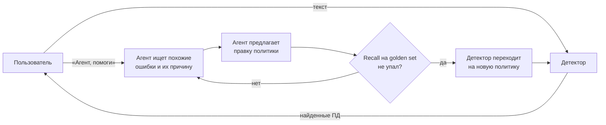
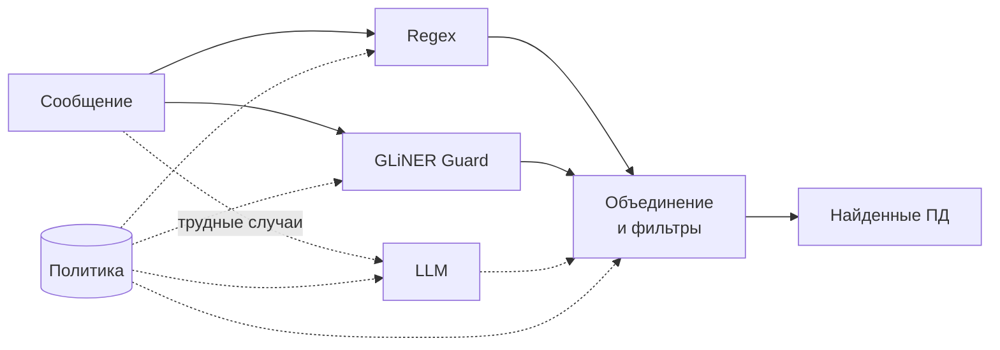
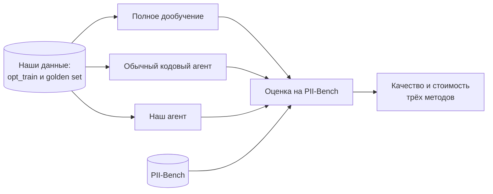

# ML System Design Doc

## Дизайн ML-системы — Self-improving PII detection, MVP, итерация 1

Локальный агент, который находит причины ошибок детектора персональных данных (ПД) в русскоязычных текстах и исправляет их прямо в работающем сервисе, без правки исходного кода

### Пояснение терминов

- **ПД** — персональные данные: ФИО, телефон, email, адрес, номера карт, CVC, ИНН, СНИЛС и т.п.
- **Детектор** — система, которая находит в тексте фрагменты (спаны) с ПД: начало, конец, тип. Бейзлайн — regex + GLiNER
- **Политика детектора** — набор правил, по которым детектор ищет ПД: regex-правила, белые и чёрные списки, метки и пороги модели, правила склейки и разрешения пересечений, правила маршрутизации в LLM, версия модели. Например, «СНИЛС может быть записан без дефисов» или «число после слова «заказ» — не ПД». Политика хранится отдельно от кода: код детектора только читает её и применяет. Поэтому агент меняет политику на работающем сервисе без правки кода и без релиза, а каждая версия политики сохраняется, и к ней можно откатиться
- **Лог срабатываний** — результат работы детектора с отметками: верное срабатывание (TP), ложное срабатывание (FP), пропуск (FN)
- **Кластер ошибок** — группа FP или FN с общей причиной ошибки: проблема с детекцией ФИО, указанных в косвенном падеже, номер заказа детектируется как ПД, адрес распознается по частям, а не как единое целое
- **Исправление** — изменение политики под кластер ошибок
- **Golden set** — размеченный набор, на котором агент проверяет каждое исправление перед внесением правки
- **Оптимизируемая часть** — данные, к которым у агента есть доступ: к текстам или только к метрикам. В неё входит golden set
- **Закрытая часть** — данные, которые агент не видит ни в каком виде. На ней один раз считается итоговое качество

### 1. Цели и предпосылки

#### 1.1. Зачем идём в разработку продукта?

**Бизнес-цель.** Клиенты хотят пропускать через LLM рабочие тексты: обращения в поддержку, переписку в мессенджерах, корпоративные документы. В этих текстах есть персональные данные. Попадание ПД в LLM создает серьезные юридические риски (152-ФЗ «О персональных данных»). Поэтому перед LLM встраивают модуль детекции ПД: NER-модуль из regex-правил и GliNER моделей. Данный модуль недостаточно надежен, существует несколько типов ошибок, которые не определяются данным модулем, клиенты регулярно приходят с новыми примерами недетектированных ПД и просят внести исправление. Между внесенным исправлением и релизом в продакшн проходит значительное время (до 1-1.5 месяцев). Соответственно, есть потребность в агенте, который смог бы в режиме реального времени улучшать детекцию ПД, при этом не внося изменения в исходный код.

**Как сейчас.** Детектор улучшает инженер вручную: читает логи пропусков и ложных срабатываний, правит regex-правила в коде, собирает данные и дообучает NER-модель, затем выкатывает новую версию. Есть белые и чёрные списки, но они не устраняют исходную причину проблемы, так как помогают разобраться только с отдельно взятыми примерами, а не с группой ошибок как таковой.

**Почему станет лучше с агентом** ошибки детектора не размазаны равномерно, а собираются в группы: сценарий (банк, доставка, HR), шаблон фразы, формат записи, тип сущности. Агент, получив одну ошибку, может найти в логе похожие, понять общую причину и подобрать самое оптимальное по стоимости исправление

**Что считаем успехом итерации**

С продуктовой точки зрения: работает сервис с фронтендом, на котором виден happy path: детектор ошибся → пользователь нажимает «Агент, помоги» → агент сам находит причину, проверяет исправление на golden set и применяет его в рантайме, не снижая recall и не ломая текущий инференс

С точки зрения исследовательской:

1. Насколько сильно кластеризуются ошибки бейзлайна (regex + GLiNER)? (в цифрах)
2. Улучшает ли агент по качеству и по стоимости инференса детектор сильнее, чем альтернативные подходы? (полное дообучение/использование обычного кодингового агента)

#### 1.2. Бизнес-требования и ограничения

**Бизнес-требования.**

| № | Требование |
|---|---|
| БТ-1 | В чувствительных сценариях пропуск ПД дороже ложного срабатывания. В обычной переписке, где ПД редки, важнее не портить текст лишними масками. Метрики учитывают оба режима. |
| БТ-2 | Исправления не требуют правки исходного кода: агент меняет только политику детектора. |
| БТ-3 | Исправление применяется в рантайме и не ломает текущий инференс: без перезапуска, без потерянных или ошибочных запросов во время переключения. Любую версию политики можно откатить. |
| БТ-4 | Исправление применяется, только если recall на golden set не падает — ни в целом, ни по отдельным типам ПД. |
| БТ-5 | Каждое исправление прозрачно: пользователь видит причину ошибки, изменение политики и замер до и после. |
| БТ-6 | Стоимость инференса важна так же, как и качество (метрики стоимости — в разделе 2.1). |
| БТ-7 | Качество каждого метода показываем двумя цифрами: на golden set, по которому метод проверял себя во время работы, и на PII-Bench, который не видел ни один метод. Разницу интерпретируем с учётом смены распределения и правил разметки; она сама по себе не доказывает подгонку. |
| БТ-8 | Три подхода (наш кастомный агент, полное дообучение, обычный кодинговый агент) сравниваются в одинаковых условиях: одни данные, один исходный детектор, одна LLM, одни инструменты, один бюджет. |

**Бизнес-ограничения**

- **Локальное развертывание:** агент и все LLM работают внутри контура. Ресурс под LLM — в лучшем случае одна H100 (80 ГБ)
- **Конфиденциальность:** в MVP используются синтетические и публичные обезличенные данные. PII-Bench синтетический; redmadrobot включает логи с заменёнными ПД и синтетические тексты. Необезличенные клиентские данные не используются
- **Эталон только для оценки:** авторы PII-Bench просят не обучаться на нём и не строить на нём обучающие данные (раздел 1.4). Поэтому данные для оптимизации нужны отдельно

**Что ожидаем от итерации:**

1. Аудит бейзлайна на данных разработки: число ошибок и их распределение по типам ПД; по сценариям — после их разметки. PII-Bench открывается для оценки моделей только в конце эксперимента
2. Агент, реализующий цепочку «анализ логов → кластеры → исправления → проверка» с исполнением в песочнице и применением исправлений через политику
3. Сервис с фронтендом
4. Сравнение агента с полным дообучением и обычным кодовым агентом по приросту метрики и по стоимости
5. Две цифры качества для каждого метода: на golden set и на PII-Bench (БТ-7)
6. Анализ ошибок после улучшения, включая слепые зоны, которые агент увидеть не мог

**Бизнес-процесс пилота**

1. Детектор работает в сервисе и маскирует ПД во входящих сообщениях. Результат виден во фронтенде и пишется в логи
2. Пользователь (оператор или инженер) замечает ошибку — пропущенные ПД или лишнюю маску — отмечает ее и просит помощи у агента
3. Агент ищет причину: находит в логе похожие ошибки, формулирует гипотезы и проверяет их
4. Лучшее исправление проверяется на golden set
5. Агент показывает причину, изменение политики и замер до и после и применяет исправление в качестве новой версии политики. Детектор переключается на нее, обработка запросов при этом не прерывается. Если что-то пошло не так, пользователь откатывается на предыдущую версию

**Что считаем успешным пилотом.**

- Happy path из раздела 1.1 работает на ошибках из разных кластеров
- На закрытой части агент показывает главную метрику (раздел 2.1) не ниже лучшего из двух бейзлайнов сравнения, а стоимость инференса растет не больше заданного порога. Порог задаем после проверки бейзлайна
- После согласования схемы разметки сравниваем разрыв качества между golden set и PII-Bench у всех методов на сопоставимых срезах. Это диагностика вместе с анализом смены распределения, а не доказательство отсутствия подгонки

**Пути развития:** агент разбирает свежий лог по расписанию (Cronjob) и сам предлагает исправления.

#### 1.3. Что входит в скоуп проекта/итерации, что не входит

**Входит:**

- Все результаты из списка «Что ожидаем от итерации» (раздел 1.2)
- Подготовка данных: оптимизируемая часть (включая golden set), закрытая часть (PII-Bench), проверка на пересечения между ними
- Проверка гипотезы о кластерах: насколько ошибки бейзлайна собираются в группы с общей причиной (способ измерения — в разделе 2.1)
- Детектор, который читает политику: версии политики хранятся, переключение атомарное, есть откат

**Не входит:**

- Продакшен-уровень сервиса: авторизация, масштабирование, мониторинг, отказоустойчивость
- Языки, кроме русского, и типы ПД вне 13 типов PII-Bench
- Замена ПД на правдоподобные значения (псевдонимизация)
- Нетекстовые данные: сканы, изображения, аудио

**Качество кода и воспроизводимость:**

- репозиторий с ruff и pre-commit, зависимости зафиксированы в `pyproject.toml`
- разбиения данных хранятся файлами со списками идентификаторов и контрольными суммами и не пересоздаются между экспериментами
- у каждого прогона свой конфиг, фиксированный seed, сохранённые метрики, стоимость, версия политики и версия LLM
- каждая версия политики хранится целиком, с причиной изменения и замером на golden set
- одна команда пересчитывает итоговую таблицу сравнения из сохраненных прогонов
- закрытая часть читается только скриптом финальной оценки, вне песочницы агента

**Планируемый технический долг:**

- песочница изолирует эксперименты на уровне процесса (отдельный процесс, лимиты времени и памяти, без сети), а не полноценным контейнером
- версии политики хранятся файлами, без базы данных, сервис и LLM работают в одном экземпляре на одной GPU
- оценка на публичных синтетических и обезличенных данных; перенос на реальные клиентские логи не проверяется

#### 1.4. Предпосылки решения

**Данные**

- **Закрытая часть — [PII-Bench](https://huggingface.co/datasets/hivetrace/pii-bench)** (HiveTrace): 1 810 русскоязычных сообщений с разметкой спанов, 13 типов ПД, 9 сценариев: чувствительные обращения и обычная переписка. Согласие разметчиков — 0,87 F1
- **Оптимизируемая часть сейчас** — [redmadrobot PII benchmark](https://huggingface.co/datasets/redmadrobot-rnd/pii_benchmark): 2 841 текст, 5 614 спанов, 21 исходный тип. После группировки близких шаблонов получены `opt_train` (1 978 текстов) и `golden` (863 текста), seed 42. Исходные имена и адреса размечены компонентами, паспорта могут быть фрагментированы; пяти целевых типов нет. Поэтому это предварительный корпус разработки, а не готовая разметка всех 13 типов. Потребность в дополнении и согласовании границ описана в этапе 1 раздела 2.3. В дальнейшем добавляем независимую синтетику: собственные сценарные шаблоны, контролируемые значения ПД и отдельные семейства шаблонов для golden, без использования текстов PII-Bench
- **Лог срабатываний** получаем прогоном детектора по `opt_train` и сравнением с разметкой

**Бейзлайн** Regex-правила + [GLiNER Guard](https://huggingface.co/hivetrace/gliner-guard-uniencoder) (147M параметров, работает на CPU). В PII-Bench у 11 из 13 типов строгий формат, их находит regex. Для `INN`, `KPP`, `OGRN`, `OGRNIP`, `SNILS`, `CVC`, `TOKEN` в модели и нет меток. Модель нужна для `NAME` и `ADDRESS`; адрес в эталоне размечен одним спаном, поэтому части адреса от модели склеиваем. Основные типы ПД, к детекции которых стоит подключать агента — это имена, адреса, короткие числа без явно заданного формата (`CVC`, `KPP`, паспорт/ номер телефона) и ложные срабатывания на числах, которые могут определяться как ПД, но не являться ими на самом деле

**Политики вместо кода** Формат файла политики задан заранее: агент может менять только значения его полей, а правку другого характера система отклоняет. Новую версию политики сначала проверяют на golden set на отдельной копии детектора, а работающий детектор в это время обслуживает запросы на старой версии. Если проверка пройдена, детектор переключается на новую версию сразу целиком.

**Локальная LLM** В одну H100 (раздел 1.2) помещается открытая модель примерно до 30B параметров в bf16; LLM-экстрактор работает на той же модели, что и агент. Чтобы задача была по силам такой модели, цепочка агента разбита на узкие шаги, а изменения политики модель возвращает строго в JSON по схеме.

**Защита от утечки между оптимизацией и оценкой** Агент много раз проверяет свои исправления и может незаметно подстроить их под данные, на которых проверяет. Чтобы итоговые цифры были честными:

- PII-Bench не видят ни агент, ни бейзлайны. На нём один раз, в самом конце, оцениваются финальные версии всех трёх методов.
- По golden set агент получает только агрегированные метрики, но не тексты, спаны или ID отдельных ошибок; число адаптивных проверок ограничено. Это снижает риск подгонки, но не исключает его
- Крайне похожие примеры (почти одинаковые) кладем в одну часть данных, а не в разные: иначе исправление, подобранное на одном сообщении, сработает на его копии в golden set и завысит результат. Отдельно проверяем, что в наших данных нет почти точных копий сообщений из PII-Bench
- Сравниваем метрики golden и PII-Bench только после согласования типов и правил разметки. Разница может возникнуть из-за подгонки, разметки или смены распределения; более сильный разрыв у агента — повод для разбора, а не однозначный вывод о причине

**Слепые зоны** Агент учится только на ошибках, которые кто-то заметил. Ложное срабатывание заметить легко: детектор замаскировал лишнее, и это видно. Пропуск же заметить трудно: детектор не обнаружил ПД, и пропуск найдётся, только если человек сам перечитает текст и разметит в нем все ПД. Поэтому:

- кроме основного эксперимента, где агенту видны все пропуски, проводим эксперимент, приближенный к реальности: пропуски видны только на 10% `opt_train`, как будто человек полностью разметил лишь малую часть сообщений. Условия одинаковые для всех трех методов
- в анализе ошибок отдельно разбираем пропуски на PII-Bench, которые не попали ни в один кластер агента: это ошибки, которые агент увидеть не мог

### 2. Методология

#### 2.1. Постановка задачи

**Базовая задача** — детекция ПД как NER на уровне символов: на входе сообщение, на выходе спаны (начало, конец, тип) из 13 типов PII-Bench.

**Исследуемая задача** — поиск по пространству изменений политики. По логу ошибок на `opt_train` нужно найти набор исправлений «кластер → изменение политики», который даёт максимальное качество на закрытой части при ограничениях БТ-4 и БТ-6. Методы сравниваем в пакетном режиме: агент сам разбирает весь лог `opt_train`, без ошибки, отмеченной пользователем.

| Исправление | Когда уместно | Стоимость инференса |
|---|---|---|
| Regex, белый или чёрный список, контекстный фильтр | ошибка формальная: формат номера, контекстное слово, конкретное значение | почти нулевая |
| Порог или описание метки GLiNER | модель ошибается на типе ПД целиком | как у бейзлайна |
| Дообучение GLiNER на кластере (с примесью остальных данных против забывания) | ошибки локальны: имена в косвенных падежах, неформальные адреса | как у бейзлайна |
| Маршрутизация в LLM | не помогает ни правило, ни модель | высокая, растёт с долей сообщений |

**Сравниваемые методы:** B1 — полное дообучение GLiNER на всём `opt_train`; B2 — обычный кодовый агент с той же LLM, инструментами и бюджетом и заданием «улучши детектор»; MVP — агент с заданной цепочкой. B2 и MVP различаются только цепочкой.

**Метрики:**

- главная — micro-F2 по спанам на финальном срезе `domain`: `F2 = 5TP / (5TP + 4FN + FP)`. Здесь FN имеет коэффициент 4 относительно FP; это выбор приоритета полноты по БТ-1, а не утверждение о точном денежном соотношении ошибок. Спан засчитывается только при точном совпадении границ и типа
- дополнительные: полнота распознавания ПД в чувствительных обращениях и точность в обычной переписке, recall по каждому типу ПД, отдельно `NAME` и `ADDRESS`; все — с 95% бутстреп-интервалами
- стоимость: миллисекунды CPU на сообщение, доля сообщений в LLM, GPU-секунды LLM на 1000 сообщений
- сервис: время от «Агент, помоги» до применения исправления, ноль сбойных запросов при переключении политики
- диагностика переноса и возможной подгонки: разрыв F2 между согласованными срезами `golden` и PII-Bench, с учётом различий распределения и разметки

**Кластеризация ошибок.** Ошибку описывают эмбеддинг контекста и признаки: тип ПД, FP или FN, сценарий, форма записи, падеж для имён. Кластеры ищем HDBSCAN (число кластеров заранее неизвестно), для ошибки пользователя — ближайших соседей в логе. Силу кластеризации меряем долей ошибок в k крупнейших кластерах и переносом: исправление, построенное на половине кластера, должно работать на другой половине.

#### 2.2. Блок-схема решения

**Как работает сервис.** Пользователь видит ошибку детектора и зовёт агента. Агент меняет политику детектора, только если recall на golden set не упал.

**Детектор.** Сплошные стрелки — бейзлайн, пунктир — то, что добавляется в MVP.

**Эксперимент.** Три метода улучшают один и тот же детектор на наших данных, а сравниваются один раз в конце на PII-Bench.

### 2.3. Этапы решения задачи

В ДЗ №2 подготовлены данные и EDA. Обучение, реализация агента и сравнение методов
описаны ниже как план следующих этапов.

#### Этап 1. Подготовка данных и EDA

**Формат данных** Одна запись — одно сообщение или один диалог. Для каждого фрагмента с ПД
указаны тип, начало и конец в исходном тексте.

| Данные / признаки | Источник и подготовка | Статус проверки |
|---|---|---|
| Текст, ID и источник | redmadrobot и PII-Bench уже скачаны, есть скрипт повторной загрузки | Проверены контрольные суммы, уникальность ID и сохранность текстов |
| Сценарий общения | В PII-Bench/domain указан, в redmadrobot нужно разметить вручную | Состав сценариев PII-Bench проверен, разметка redmadrobot еще не подготовлена |
| Группы похожих сообщений | Готовый скрипт сравнивает тексты и шаблоны с замененными значениями ПД | Проверено: каждая группа целиком попадает в одну часть данных |
| Токены, контекст и форматы номеров | Подготовить при реализации детектора | Пока не проверено: нужны проверки границ ПД и длинных сообщений |

| Целевая переменная | Источник | Ограничение |
|---|---|---|
| Фрагменты 13 целевых типов ПД | PII-Bench: 1 810 сообщений, 1 667 фрагментов | Только для финальной оценки |
| Исходная разметка для разработки | redmadrobot: 2 841 сообщение, 5 614 фрагментов, 21 тип | Метки токенов переведены в границы фрагментов; правила разметки нужно согласовать с целевой схемой |
| Пропуски, ложные срабатывания и причины ошибок | Будут получены после запуска исходного детектора на `opt_train` | Нужны детектор и согласованная разметка |

**Получение данных** Данные загружены разово: redmadrobot — CSV с текстами,
токенами и метками, PII-Bench — два файла Parquet. Скрипты преобразуют их в JSONL,
проверяют и разбивают на выборки. Подготовку и проверки выполняет ML-инженер.

Все методы используют одинаковые данные. Redmadrobot разделён на
`opt_train` (1 978 сообщений) для обучения и анализа ошибок и `golden` (863 сообщения)
для проверки изменений. Методы получают от golden только сводные метрики.
PII-Bench используется один раз в конце для оценки и не включен в обучающую выборку. Версии источников, контрольные суммы и списки ID сохранены.
Обновление данных требует повторной проверки разбиения.

**Выводы EDA** Подробности и графики — в [отчёте](../eda/report.md).

- В redmadrobot найдено 2 687 групп похожих текстов, 113 групп содержат несколько
  сообщений. Группы разделены примерно в пропорции 70/30 с seed 42. Пересечений ID,
  нормализованных текстов и групп между частями не найдено. Между источниками
  совпадений по тем же правилам также нет; смысловое сходство этим не исключается
- Пять типов отсутствуют: `CVC`, `KPP`, `OGRN`, `OGRNIP`, `TOKEN`. Для `NAME`,
  `ADDRESS`, `PASSPORT` нужно согласовать границы разметки. `PHONE`, `EMAIL`,
  `CREDIT_CARD`, `INN`, `SNILS` предварительно совместимы, но требуют ручной проверки
  Отсутствие метки вне схемы источника не означает отсутствие ПД в тексте
- В redmadrobot 13,1% сообщений без размеченных ПД, в PII-Bench/domain — 42%
- Тексты redmadrobot длиннее: 95% укладываются в 741 символ, у PII-Bench — в 215
  Перед обучением нужно проверить длину в токенах и обработку текста по частям

**Пополнение и разметка** Начальный ориентир -- 200 согласованных фрагментов каждого
типа в `opt_train` и 100 в golden. Дефицит -- 1 830 и 987 фрагментов соответственно:
1 500 относятся к отсутствующим типам, 900 -- к именам, адресам и паспортам,
417 -- к предварительно совместимым типам. Часть дефицита закроет переразметка.

Новые сообщения создаём из собственных сценарных заготовок с синтетическими ПД.
Часть сообщений пишем вручную.
Добавляем номера заказов, суммы и даты как примеры без ПД. Начальный ориентир —
30–40% таких сообщений и покрытие девяти сценариев общения.

**Конфиденциальность** PII-Bench синтетический. В датасетн redmadrobot представлены реальные логи, но значения ПД
заменены на синтетические.

**Результат этапа и проверка** Сейчас готовы датасеты, разбиения, ноутбук и отчет.
До полного эксперимента нужно согласовать схему разметки
13 типов сущностей и сценариев, проверить сложные примеры и покрытие классов.

#### Этап 2. Подготовка детектора и методов сравнения

**Задача** Для каждого сообщения найти фрагменты ПД и определить их типы.
Временного горизонта прогноза нет. Модель обновляется отдельным экспериментом
после пополнения данных или анализа ошибок.

| Вариант | Что делает | Как выбирается результат |
|---|---|---|
| Исходный детектор | Regex и GLiNER Guard с фиксированной политикой | Ориентир для сравнения |
| Дообученная модель | Обучает все веса GLiNER на `opt_train`; regex и обработка предсказаний фиксированы | Внутренняя валидация, затем проверки на golden-сете |
| Обычный агент | Улучшает политику по общему заданию, без обязательной последовательности шагов | Общие метрики и заранее заданные ограничения |
| Наш агент | Группирует ошибки, формулирует гипотезы и проверяет изменения политики | Та же программа оценки качества и заранее заданные ограничения |

В качестве модели берем `hivetrace/gliner-guard-uniencoder`, выбранную в разделе 1.4.
Перед запуском фиксируем версии модели, библиотеки, токенизатора и настройки.
Исходный текст сохраняем, чтобы не сместить границы ПД. Длинные сообщения
обрабатываем перекрывающимися частями и объединяем ответы. Размер частей,
пороги и правила объединения выбираем на внутренней валидации.

**Выбор метрик** Основная метрика — строгая micro-F2. Она нужна для выбора
исправлений, которые уменьшают пропуски ПД, сохраняя контроль над лишними масками.
F2 сильнее учитывает полноту, чем F1: в формуле `5TP / (5TP + 4FN + FP)` пропуск
имеет коэффициент 4, ложное срабатывание — 1. Одного recall недостаточно: его можно повысить,
если выделять слишком много фрагментов как ПД. В целом что-то лишнее пометить как ПД нестрашно, но в данной задаче все равно агент может достаточно легко хакнуть эту метрику.

Строгое совпадение требует правильного типа и обеих границ. Частично найденный
номер или адрес может оставить ПД открытыми, а слишком широкий фрагмент — скрыть
полезный текст. Оценка только по пересечению фрагментов не отражает эти ошибки.
Micro означает, что TP, FP и FN сначала суммируются по всем типам: получаем общую
оценку распознавания сущностей. При этом частые типы влияют сильнее редких.

Поэтому дополнительно проверяем:

- **Recall каждого типа:** улучшение на частых телефонах не должно скрывать
  ухудшение на редких типах. Отдельно смотрим `NAME` и `ADDRESS`, где EDA выявил
  различия в границах разметки. Это также проверка БТ-4.
- **Recall в чувствительных обращениях и precision в обычной переписке:**
  в первом случае важнее не пропустить ПД, во втором — не скрыть лишний текст.
  Precision показывает долю верных срабатываний среди всех предсказаний.
- **Число ложных срабатываний на сообщение без ПД:** показывает, сколько лишних
  масок в среднем приходится на такой текст. Precision для такого
  набора не показывает масштаб проблемы: при любых срабатываниях он равен нулю.
- **F1:** дополнительная оценка с равным приоритетом precision и recall,
  позволяющая увидеть, какой баланс ошибок стоит за изменением F2.

Основной итог считаем на PII-Bench/domain: там есть разные сценарии и сообщения
без ПД. F2 выбирает лучшую версию только среди кандидатов, прошедших
ограничения по recall, precision и стоимости из этапа 5.

**Общяя оценка** Для всех четырёх вариантов одинаковы правила расчёта метрик.
Формулы и разметку во время поиска исправлений не меняем.

Ошибочная граница дает и ложное срабатывание, и пропуск, повторное предсказание
не считается еще одним правильным ответом. Метрика с нулевым знаменателем
помечается как недоступная. 
Показываем результаты до и после объединения фрагментов и применения фильтров.
Стоимость поиска изменений и обработки сообщений измеряем отдельно на одном оборудовании.
Задержка p95 показывает время ответа для большинства запросов с учётом медленных
случаев. CPU/GPU-время и память отражают необходимые
ресурсы, а доля вызовов LLM показывает, как часто используется дорогой способ обработки.
Так прирост качества можно сопоставить с затратами и ограничениями сервиса по БТ-6.

**Функция потерь** F2 служит для оценки готовых предсказаний и выбора порогов.
Для дообучения берем бинарную кросс-энтропию по парам «фрагмент — тип»:
`L = -mean(y*log(p) + (1-y)*log(1-p))`, т.к. она штрафует уверенные ошибочные ответы.

**Проверка моделей и ограничения эксперимента**

1. `opt_train` дополнительно делим по группам примерно 80/20 для выбора параметров.
   Golden и PII-Bench не используются для настройки обработки текста и ранней остановки.
2. Для дообученной модели проверяем скорости обучения кодировщика `{5e-6, 1e-5, 2e-5}` и выходных
   слоёв `{1e-4, 5e-4}`, до 10 эпох, остановка после двух эпох без улучшения F2.
   Порог — от 0,2 до 0,8 с шагом 0,1. 
   Затем обучаем на всём `opt_train` с выбранными параметрами и числом эпох.
3. На метод и seed допускаем до 20 проверок golden и 7 200 GPU-секунд, включая
   поиск и обучение. Для обычного кодового агента и нашего "доработанного" агента дополнительно — до 60 000 сгенерированных LLM-токенов.
   Лимиты предварительные: уточняем на данных разработки и фиксируем до этапа оценки. 
4. Стохастические методы запускаем с seed 42, 43, 44 при неизменных внешних выборках.
   Обычный кодовый агент и наш  получают одинаковые LLM, инструменты, данные и вычислительные ресурсы.
5. Выбранные варианты оцениваем на PII-Bench одним финальным прогоном.
   Для доверительных интервалов и разницы методов используем 2 000 повторных
   выборок целых групп сообщений (парный bootstrap), сохраняя сценарные срезы.

**Дальнейшее развитие и риски** Сначала проверяем исходный детектор, затем пороги и контекстные правила,
после — дообучение и обращение к LLM в сложных случаях. Пользу каждого изменения
проверяем отдельно. Чтобы дообучение на группе ошибок не ухудшало остальные типы,
добавляем примеры из других групп. Основные риски включают в себя ошибки разметки
и подгонку под golden-сет.

**Результат этапа** Исходный детектор, дообученная модель, обычный агент и общая
оценками с зафиксированными настройками и ресурсами в виде железа. Наш агент будет собран на этапе 4.
ML-инженер сверяет расчет метрик на контрольных примерах, сами значения появятся после эксперимента.

#### Этап 3. Анализ и группировка ошибок

**Входы** Предсказания и разметка `opt_train`. Разбираем пропуски, лишние маски,
неверные типы и границы после каждого прогона кандидата. Тексты и отдельные ошибки
из golden и PII-Bench агентам недоступны.

**Сравниваемые подходы** Для исходного детектора и дообученной модели группируем ошибки по типу, формату, длине и сценарию
при наличии разметки. Обычный агент получает тот же журнал. Наш агент дополнительно объединяет
похожие контексты с помощью эмбеддингов, заменяя значения ПД метками типов.
Для кластеризации проверяем HDBSCAN с `min_cluster_size` 5, 10 и 20.
Версию модели эмбеддингов фиксируем, стоимость учитываем в бюджете.

**Проверка и результат** Измеряем долю ошибок в пяти и десяти крупнейших кластерах,
долю ошибок вне кластеров и число независимых групп шаблонов в каждом кластере.
Вручную проверяем до 10 примеров из приоритетных кластеров. Исправление строим
на одних группах `opt_train`, проверяем на других.

Здесь есть риск объединить тексты по стилю или шаблону, ошибочно приписав им общую причину.
Поэтому сравниваем кластеризацию с простой группировкой и проверяем пользу исправлений.
В результате должен быть журнал с причинами ошибок и гипотезами их возникновения для агента. 

#### Этап 4. Разработка нашего агента

**Входы и цель** Ошибка пользователя или кластер из этапа 3, текущая политика,
`opt_train` и система оценки. Выбираем вариант политики детектора с наибольшей F2
среди тех, которые прошли проверки качества и ограничений из этапа 5.
В пилоте поиск запускается по запросу оператора, в эксперименте — по журналу ошибок, который упоминался выше. 

**Сравниваемые подходы** Для дообученной модели выбираем параметры и версию весов.
Обычный агент получает общее задание улучшить детектор. Наш агент следует цепочке:
«кластер → причина → гипотеза → изменение → проверка → отчёт».
Сначала проверяет правила и пороги, затем дообучение и обращение к LLM.
При дообучении на кластере добавляет примеры других типов, чтобы сохранить их качество.
Каждое предложенное исправление оформляется как новая версия политики детектора:
изменённые правила, пороги, настройки или ссылка на дообученные веса.
До прохождения проверки качества эта версия называется кандидатом.
Для каждой попытки сохраняются причина ошибки, гипотеза,
изменение, метрики и затраты. Код детектора и оценщика агент не меняет.

**Поиск и остановка.** Каждое предложенное исправление сначала проверяем на данных
разработки, затем — на golden-сете через систему оценки. Соблюдаем ограничения на время
и вычислительные ресурсы из этапа 2.

Среди вариантов политики, прошедших проверки этапа 5, выбираем вариант с наибольшей F2.
При одинаковой F2 предпочитаем тот, который реже обращается к LLM, затем — тот, что быстрее
обрабатывает сообщения. Если и эти показатели совпадают, оставляем вариант,
предложенный раньше.

Прекращаем поиск, когда исчерпаны выделенные ресурсы, выполнено 20 проверок на golden-сете
или пять исправлений подряд не улучшили лучший найденный результат. Если улучшить
текущую политику не удалось, оставляем её без изменений.

**Риски и результат** Повторные проверки могут привести к подгонке под golden,
а исправление одной группы — ухудшить другие. Ограничиваем число проверок,
проверяем все типы и сохраняем PII-Bench для финала. Результат — выбранная политика
с объяснением и метриками либо отказ от изменения. Оператор проверяет понятность причины и предложенного исправления.
Применение, откат и проверка полного пользовательского сценария описаны на этапе 5.

#### Этап 5. Проверка и применение исправлений

**Входы и цель.** Предложенный вариант политики детектора, действующая политика
и результаты их проверки одной системой оценки. Проверяем, улучшает ли исправление
качество, сохраняет ли распознавание каждого типа ПД и укладывается ли в ограничения
по ресурсам без сбоев сервиса.

Если модель дообучена, в новой политике указывается ссылка на её веса. Обычный и наш
агенты оформляют изменения одинаково и проходят одинаковые проверки перед применением.
Для дообученной модели проверки запускает ML-инженер, для исправлений нашего агента — сам агент.

**Условия применения** Каждый кандидат проверяется отдельно:

- Меняются только разрешённые поля политики, без правки кода детектора и оценщика.
- Recall на golden-сете не падает в целом и по каждому из 13 типов. При недостатке
  разметки типа или сценария соответствующая проверка не считается пройденной.
- Precision в обычной переписке не ниже, чем у исходного детектора. Если предсказаний
  нет, отдельно проверяем число ложных срабатываний и причину отсутствия ответов.
- Предварительные лимиты: LLM вызывается не более чем для 10% сообщений,
  p95 задержки не превышает 120% от p95 исходного детектора.
  Лимиты уточняем на данных разработки до сравнения методов.
- Новая политика загружена и проверена на пробных запросах. Можно вернуться
  к предыдущей политике. Сохранены причина изменения и показатели качества
  до и после исправления.

Точечные метрики дополняем интервалами: равный recall не гарантирует отсутствие
ухудшений на новых данных. Качество проверяет оценщик golden, технические проверки
выполняются на данных разработки. PII-Bench в допуске исправлений не участвует.

**Работа сервиса** На входе — сообщение и версия политики, на выходе — найденные
фрагменты ПД, ID политики и замер ресурсов. Для сложных случаев можно вызвать
локальную LLM. Проверяем, что LLM указала допустимые типы ПД и правильно выделила
соответствующие фрагменты исходного текста.

Новую политику и необходимые модели загружаем отдельно и проверяем на пробных запросах.
После успешного прохождения всех проверок новые запросы обрабатываются по новой политике,
а уже начатые — по прежней. Если при подготовке возникает ошибка, сервис продолжает
работать с действующей политикой. Предыдущую политику и модели сохраняем, чтобы
при необходимости вернуть их в работу.

**Риски и проверки** Медленные регулярные выражения и неверные ответы LLM
ограничиваем тайм-аутами, лимитами ресурсов и проверкой формата. Изменения проверяем
в изолированном процессе без сети. Пользовательский текст обрабатываем как данные.
На коротких и длинных сообщениях, диалогах и текстах без ПД проверяем качество масок
и соответствие границ в сервисе и интерфейсе. Под параллельной нагрузкой проверяем
смену версии: не должно быть потерянных или ошибочных запросов. Если памяти
не хватает для одновременной загрузки двух моделей, переключение без перерыва
пока не обеспечено.

**Результат и проверка работы сервиса** Сервис позволяет применять новую политику
и возвращаться к предыдущей. Для каждого предложенного изменения сохраняются решение
о применении или отклонении и его причина.

Необходимо проверить, что полезное исправление применяется,
а изменение, которое ухудшает распознавание хотя бы одного типа ПД, превышает
ограничения по ресурсам или содержит недопустимые настройки, отклоняется.

Оператор проверяет весь сценарий: сообщает об ошибке, запускает помощь агента,
получает результат проверки, применяет исправление и при необходимости возвращает
предыдущую политику. В пилоте измеряем число успешных исправлений и время от обращения
оператора до применения исправления.

#### Этап 6. Итоговое сравнение методов

**Входы и оценка** Зафиксированные версии исходного детектора, дообученной модели
и двух агентов для каждого seed, результаты измерения времени работы и использования
вычислительных ресурсов,
golden и отдельный PII-Bench. Финальную оценку проводим один раз после выбора версий.
При реализации нужно проверить, что агенты не имеют доступа к текстам PII-Bench:
раздельных каталогов для этого недостаточно.

**Содержание отчёта** Сравниваем F2 на PII-Bench/domain, recall по типам, качество
в чувствительных обращениях и обычной переписке, стоимость поиска и обработки,
задержку и память. PII-Bench/entity показываем отдельно: там нет сообщений без ПД.
Добавляем доверительные интервалы, сравнение с golden и разбор оставшихся ошибок.
Разницу между golden и PII-Bench рассматриваем с учетом различий текстов и разметки.

**Дополнительный эксперимент.** Проверяем, насколько методы могут улучшить детектор,
если им известна только часть пропущенных персональных данных. Для этого случайно
выбираем 10% групп `opt_train` и показываем методам разметку пропусков только в этих группах.

Дообученная модель, обычный и наш агенты получают одинаковую информацию. Полная разметка
доступна только системе оценки, чтобы измерять качество на всех примерах. В остальных
группах отсутствие доступной метки не означает отсутствие ПД: такие фрагменты нельзя
использовать как примеры без персональных данных.

**Результат и бизнес-проверка** Владелец продукта получает таблицу качества
и затрат, ограничения и решение о переходе к пилоту. Ориентир успеха — F2 нашего агента
не ниже лучшего результата дообученной модели и обычного агента при соблюдении ограничений recall и стоимости, а также
рабочее исправление и откат. Выводы о превосходстве учитывают неопределённость метрик.
После просмотра PII-Bench настройку в этой итерации прекращаем: дальнейшие изменения
потребуют новой независимой оценки. В ДЗ №2 подготовлен протокол сравнения;
результаты моделей и пилота пока не получены.
