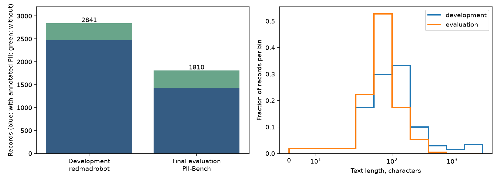
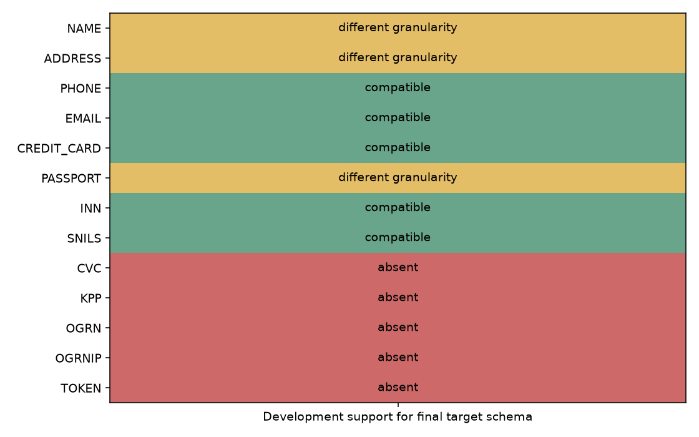
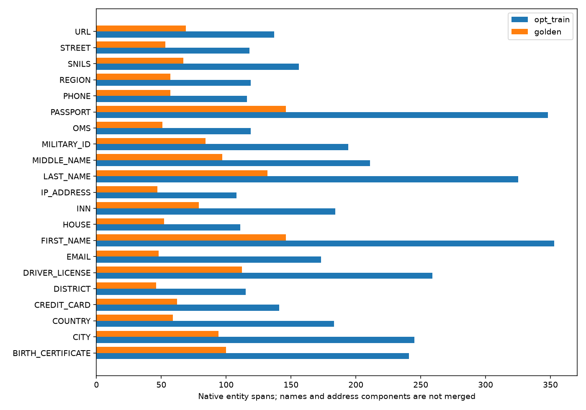
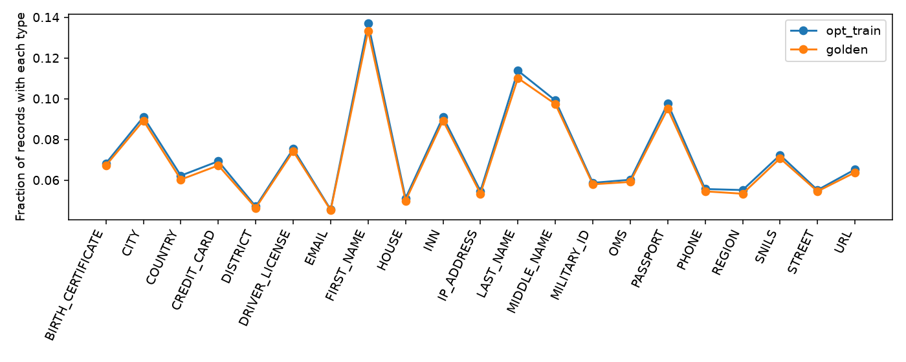
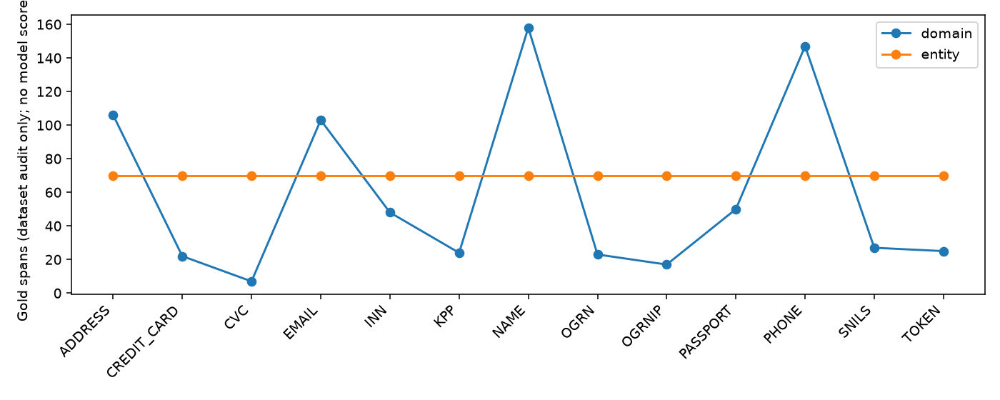

# EDA: данные для self-improving PII detection

Проверяем, подходят ли собранные данные для поиска ошибок детектора ПД,
подбора исправлений и проверки их качества.

[Ноутбук с расчётами](../notebooks/eda.ipynb) ·
[Как подготовить данные](../data/README.md) ·
[Дизайн-док](../docs/ml_system_design_doc.md#23-этапы-решения-задачи)

## Источники данных и кода

Наработки перенесены из `self-improving-pii` (ветка `data`, базовый коммит `24195b4`
и рабочие изменения). При переносе разделены данные разработки и итоговой оценки.
Версии источников и контрольные суммы указаны в `scripts/data/sources.py`;
параметры подготовки и результаты проверок сохранены рядом с отчётом.
Дата анализа — 14.11.2026.

| Источник | Сообщения | Размеченные сущности | Назначение |
|---|---:|---:|---|
| [redmadrobot](https://huggingface.co/datasets/redmadrobot-rnd/pii_benchmark/tree/f77ea831274daf980cc45c61a93c226be9d978d6) | 2 841 | 5 614 | Разработка и проверка исправлений |
| [PII-Bench/domain](https://huggingface.co/datasets/hivetrace/pii-bench/tree/cd6a18ace16daf23e79247ccf1e2b245d4054654) | 900 | 757 | Итоговая оценка в разных сценариях общения |
| PII-Bench/entity | 910 | 910 | Итоговая оценка отдельных типов ПД |
| **Всего** | **4 651** | **7 281** | |

PII-Bench содержит синтетические тексты, лицензия — Apache-2.0.
Redmadrobot сочетает логи с заменёнными ПД, синтетические документы и примеры,
на которых детектор может ошибочно найти ПД; лицензия — MIT.

**Вывод.** Для разработки используем redmadrobot. PII-Bench оставляем для
заключительной оценки: на нём не обучаем модель и не подбираем исправления.
Ранее подготовленное общее разбиение не использовалось для обучения или настройки.

## 1. Качество разметки

Проверены контрольные суммы исходных файлов, уникальность ID, непустые тексты,
правильность последовательности меток и границы выделенных сущностей.
Каждый размеченный фрагмент должен точно совпадать с соответствующим участком текста.

При преобразовании redmadrobot учтены три особенности: в двух случаях токен `WWW`
записан в тексте как `www`, в одном — найден пустой токен без сущности.
Исходные тексты и разметка сохранены. Подробности — в
[журнале преобразования](development_corrections.json).

**Вывод.** Автоматические проверки пройдены. Они подтверждают правильность формата,
но не гарантируют, что все ПД найдены и размечены верно. Сложные примеры нужно
дополнительно проверить вручную.

## 2. Длина сообщений и тексты без ПД

| Источник | Медиана длины | Около 95% сообщений не длиннее | Максимум |
|---|---:|---:|---:|
| redmadrobot | 102 символа | 741 символ | 2 574 символа |
| PII-Bench | 70,5 символа | 214,55 символа | 520 символов |

**Вывод.** В redmadrobot больше длинных текстов. Перед запуском модели нужно
проверить, помещаются ли они в её входное окно и не теряются ли сущности при обрезке.
Длина в символах сама по себе не определяет длину в токенах модели.

В redmadrobot 371 сообщение без размеченных ПД — 13,1% корпуса.
В PII-Bench/domain таких сообщений 378 из 900 — 42%.
Они нужны для проверки лишних масок, например на номерах заказов, суммах и датах.
Такие сообщения считаем отрицательными только для тех типов ПД, которые размечались
в соответствующем источнике.

**Вывод.** Нужно сохранять и пополнять примеры без ПД: хорошее распознавание
сущностей ещё не означает, что детектор редко маскирует лишнее.

## 3. Различия схем разметки

В проекте остаются 13 целевых типов ПД из PII-Bench. В redmadrobot размечен 21 тип,
но правила выделения сущностей отличаются.

| Типы ПД | Что есть в redmadrobot | Что нужно сделать |
|---|---|---|
| PHONE, EMAIL, CREDIT_CARD, INN, SNILS | Разметка предварительно считается совместимой | Проверить примеры вручную |
| NAME | Имя, фамилия и отчество выделены отдельно | Согласовать выделение имени целиком |
| ADDRESS | Страна, город, улица и другие части выделены отдельно | Проверить, где они образуют единый адрес |
| PASSPORT | Серия и номер могут быть отдельными фрагментами | Согласовать границы паспортных данных |
| CVC, KPP, OGRN, OGRNIP, TOKEN | Примеров нет | Собрать и разметить данные |

Переименованы только `PHONE_NUMBER → PHONE`, `BANK_CARD_NUMBER → CREDIT_CARD`
и `PASSPORT_NUMBER → PASSPORT`. Границы выделенных фрагментов не менялись.

**Вывод.** Перед совместным обучением или оценкой нужно согласовать правила разметки.
Пока нельзя проверить качество по всем 13 типам: для пяти нет примеров,
а у трёх различаются границы. Неразмеченный в источнике тип нельзя автоматически
считать отсутствующим в тексте.

## 4. Похожие сообщения и разбиение данных

Сообщения, отличающиеся только значениями ПД, объединяем в группы. Например,
два текста «Позвоните мне по номеру …» с разными телефонами имеют один шаблон.
Также учитываем регистр, лишние пробелы и близкие формулировки.
Точный способ сравнения описан в [инструкции](../data/README.md).

Каждая группа целиком попадает в одну из двух выборок:

| Выборка | Сообщения | Размеченные сущности | Для чего используется |
|---|---:|---:|---|
| `opt_train` | 1 978 | 3 956 | Агент изучает ошибки и подбирает исправления; модель может обучаться |
| `golden` | 863 | 1 658 | Отдельный оценщик проверяет исправления и возвращает агенту только метрики |

Из 2 841 сообщения получено 2 687 групп. В 113 группах несколько сообщений —
всего 267 текстов. Самая большая группа содержит 10 сообщений.
Разбиение близко к 70/30; seed 42 позволяет повторить его на тех же данных.
ID и группы сохранены в [development.json](../data/splits/development.json).

**Вывод.** Между выборками не найдено общих ID, совпадающих после нормализации
текстов или сообщений из одной группы. Отдельная проверка двух источников также
не обнаружила совпадений по выбранным правилам. Это снижает риск завышенной оценки
на похожих примерах, но не исключает все смысловые повторы.

## 5. Баланс типов ПД и сценарии общения

**Вывод.** Все 21 исходный тип redmadrobot есть и в `opt_train`, и в `golden`.
Выборки разного размера, поэтому сравниваем доли сообщений с каждым типом,
а не только число сущностей. Будущее качество детектора нужно показывать по типам:
общая метрика может скрыть ошибки на редких классах. При оценке неопределенности
учитываем, что сущности в одном сообщении связаны между собой.

В redmadrobot сценарии общения не указаны. Девять размеченных сценариев есть
в PII-Bench/domain. В PII-Bench/entity поле `domain` обозначает тип сущности.
Во всех 910 сообщениях `entity` есть ПД, а в `domain` есть и тексты без ПД.

**Вывод.** Результаты этих двух наборов нужно показывать отдельно. Для разработки
еще нужна разметка чувствительных обращений и обычной переписки.

## 6. Сколько данных еще нужно

Для планирования взят рабочий ориентир: 200 размеченных сущностей каждого типа
в `opt_train` и 100 в `golden-сет`. Достаточность этого объема нужно проверить
экспериментами. Имена, адреса и паспорта пока не засчитываются в этот минимум,
поскольку их разметку сначала нужно согласовать.

| Что дополнить | `opt_train` | `golden` |
|---|---:|---:|
| Пять отсутствующих типов | 1 000 | 500 |
| Имена, адреса и паспорта | 600 | 300 |
| Остальные пять типов | 230 | 187 |
| **Всего сущностей** | **1 830** | **987** |

**Вывод.** Предварительно не хватает 2 817 размеченных сущностей. Это не обязательно
столько же новых сообщений: один текст может содержать несколько сущностей,
а часть дефицита закроется переразметкой уже собранных данных.
Расчёт по каждому типу — в [target_coverage.csv](target_coverage.csv).

Дальше нужно:

1. Согласовать разметку имен, адресов и паспортов и проверить сложные примеры вручную
2. Добавить недостающие типы ПД и тексты без ПД, похожие на положительные примеры
3. Разметить сценарии общения и использовать отдельные шаблоны для `golden-сета`
4. Проверить достаточность данных на первых экспериментах с детектором

Новые тексты создаются без использования примеров PII-Bench
Генерация, переразметка и обучение пока не выполнены
